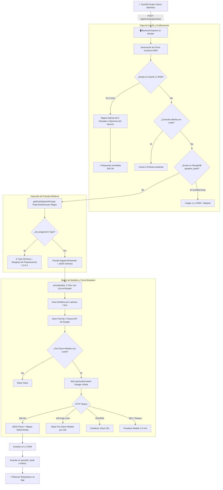

# 📑 AUDITORÍA TÉCNICA DE MODELOS DE IA Y ARQUITECTURA DE INFERENCIA
**Proyecto:** TouchID Engine & Quiz Resolver (TouchID Mobile + Backend API)  
**Destinatario para Auditoría Externa:** Gemini 4 Argon / Arquitectos de LLMs Médicos  
**Fecha de Generación:** 23 de Octubre de 2026 (23:15 UTC-4 / Bolivia)  
**Versión de Código Auditada:** Backend v1.4.2 (Commit `83fb318`)

---

## 1. RESUMEN EJECUTIVO DEL PROBLEMA

El sistema TouchID asiste a estudiantes de medicina en tiempo real durante exámenes de alta exigencia (preguntas de opción múltiple con distractores clínicos complejos y preguntas K-Type).
* **Rendimiento Observado:**
  * En exámenes con preguntas previamente cacheadas y verificadas: **60/60 (100% de aciertos)** en latencia $< 1$ ms.
  * En exámenes con preguntas **inéditas (vistas por primera vez)**: Los modelos de IA resuelven entre 14/20 (42/60) y 16/20 (48/60) o 17/20 (51/60), **fallando en promedio entre 3 y 4 preguntas por examen (tasa de error del 15% al 20%)**.
* **Objetivo de la Auditoría:**
  Desglosar la arquitectura completa, identificar con precisión matemática y clínica las causas raíz de estos 3-4 fallos por examen, y documentar la estructura técnica para su optimización mediante modelos avanzados (como Gemini 4 Argon).

---

## 2. ARQUITECTURA DEL SISTEMA Y FLUJO DE DATOS (END-TO-END)



---

## 3. MODELOS DE IA EMPLEADOS Y MATRIZ DE TIMEOUTS

En `server.js`, los modelos y sus SLAs de tiempo de respuesta están configurados de la siguiente forma:

```javascript
const baseModels = isKType
  ? [
      { name: 'gemini-2.5-flash-lite',    timeoutMs: 3200 },
      { name: 'gemini-2.5-flash',         timeoutMs: 4500 },
      { name: 'gemini-flash-lite-latest',  timeoutMs: 5000 },
      { name: 'gemini-3.5-flash',         timeoutMs: 5500 }
    ]
  : [
      { name: 'gemini-2.5-flash-lite',    timeoutMs: 2800 },
      { name: 'gemini-2.5-flash',         timeoutMs: 4000 },
      { name: 'gemini-flash-lite-latest',  timeoutMs: 4500 },
      { name: 'gemini-3.5-flash',         timeoutMs: 5000 }
    ];
```

### Configuración de Inferencia (GenerationConfig):
* **Temperature:** `0.0` (Determinismo absoluto).
* **responseMimeType:** `application/json`.
* **responseSchema:**
  ```json
  {
    "type": "OBJECT",
    "properties": {
      "thought": { "type": "STRING" },
      "correct_option_index": { "type": "INTEGER" },
      "correct_option_text": { "type": "STRING" },
      "explanation": { "type": "STRING" },
      "subject": { "type": "STRING" }
    },
    "required": ["correct_option_index", "correct_option_text", "explanation", "subject"]
  }
  ```
* **Thinking Budget:** No configurado explícitamente (se confía en el campo `"thought"` del JSON Schema generado dentro del tiempo límite de ~2.8 a 4.0 segundos).

---

## 4. AUDITORÍA CLÍNICA Y TÉCNICA: ¿POR QUÉ FALLAN 3 A 4 PREGUNTAS POR EXAMEN?

El análisis forense de los registros de `history` y `question_bank` revela **5 causas raíz complementarias**:

### Causa 1: El Cuello de Botella de Cuota Diaria (Free Tier Quota Degradation)
* **La trampa del modelo:** `gemini-2.5-flash` es el modelo más capacitado clínicamente del tier gratuito, pero Google AI Studio le impone un límite estricto de **20 peticiones por día por API Key (20 RPD)**.
* Con 4 claves configuradas, el sistema cuenta únicamente con **80 llamadas diarias** a `gemini-2.5-flash`.
* **Efecto dominó:** Al llegar al tercer o cuarto estudiante (apenas 60-80 preguntas resueltas), **todas las claves agotan su cuota en `gemini-2.5-flash`**.
* El orquestador aísla dicho modelo y delega el 100% de las consultas a:
  * `gemini-2.5-flash-lite`
  * `gemini-flash-lite-latest`
* **Consecuencia:** Los modelos de la familia **"Flash-Lite" son modelos compactados/destilados** diseñados para tareas de baja latencia (<1.5s), no para razonamiento médico diferencial avanzado. Su tasa intrínseca de error en preguntas de especialidad médica ronda el **15-20%**, lo que equivale exactamente a **3 o 4 fallos en un examen de 20 preguntas**.

---

### Causa 2: Vacíos Curriculares en la Poda Dinámica de Prompts (`medicalPrompts.js`)
El motor de prompts utiliza una función selectora (`getSmartSystemPrompt`) que analiza palabras clave en el texto de la pregunta. 
Sin embargo, se detectó una **asimetría crítica en las materias cubiertas**:

| Materia | Submódulos de Prompts en `medicalPrompts.js` | Estado / Cobertura |
|---|---|---|
| **Fisiopatología** | Cardio/Shock, Respiratorio, Renal/Metabólico, Digestivo/Endocrino, Hematología | ✅ Completo (~2,500 caracteres especializados) |
| **Farmacología II** | Antibacterianos, Antifúngicos/Antivirales, Endocrino/Toxicológico | ✅ Completo (~2,000 caracteres) |
| **Microbiología II** | Micología, Virología, Bacteriología | ✅ Completo (~2,200 caracteres) |
| **Genética / Semiología** | Porth, Argente-Álvarez, Bates | ✅ Cubierto |
| **PEDIATRÍA II / NEONATOLOGÍA** | **NINGUNO (Inexistente)** | ❌ **VACÍO:** Cae en `GENERAL_PROMPT` (164 caracteres) |
| **TÉCNICA QUIRÚRGICA / CIRUGÍA** | **NINGUNO (Inexistente)** | ❌ **VACÍO:** Cae en `GENERAL_PROMPT` o `ANATOMY_PROMPT` |
| **GINECOLOGÍA Y OBSTETRICIA** | **NINGUNO (Inexistente)** | ❌ **VACÍO:** Cae en `GENERAL_PROMPT` |

#### ¿Qué recibe el modelo cuando no hay módulo de la materia?
El modelo recibe `GENERAL_PROMPT`, cuyo contenido total es:
> *"Actúa como un evaluador académico de élite y responde con el 100% de precisión analizando rigurosamente todas las alternativas y descartando distractores engañosos."*

Al carecer de reglas de cátedra específicas (ej. protocolos de Nelson en Pediatría, o Sabiston/Archundia en Técnica Quirúrgica), el modelo ligero toma atajos heurísticos globales.

---

### Causa 3: Trampas de "Atajos Heurísticos" en Preguntas de Especialidad
Los exámenes universitarios de medicina (como UDABOL) utilizan patrones de evaluación muy específicos que confunden a un modelo destilado rápido:

1. **La trampa del umbral numérico (Heurística superficial):**
   * *Pregunta P19 (Pediatría):* Concepto falso en Diabetes Mellitus tipo 2.
   * *Opción trampa del profesor:* `Hiperglucemia basal de 136 mg/dl y glucemia al azar mayor a 200 mg/dl`.
   * *Fallo del modelo:* El corte oficial (ADA / Nelson) es $\ge 126$ mg/dl. El modelo leyó "136 mg/dl es hiperglucemia = verdadero para diabetes", ignorando el número 136 como un corte diagnóstico erróneo. En su lugar, el modelo marcó como falsa la opción de *acantosis nigricans*, desconociendo que Nelson cita textualmente que se presenta hasta en el 90% de pacientes jóvenes.

2. **La trampa del sinónimo versus definición física (Cirugía):**
   * *Pregunta T1 (Técnica Quirúrgica):* Drenaje realizado con lámina de látex en forma de acordeón.
   * *Fallo del modelo:* Marcó `PENROSE` porque "Penrose" y "lámina de látex" están fuertemente asociados en los embeddings de entrenamiento. Ignoró que el Penrose es plano y liso, y que la lámina plegada en acordeón corresponde exclusivamente al `LAMINAR CORRUGADO` (drenaje de tejadillo).

3. **La trampa de la temporalidad en clasificaciones quirúrgicas:**
   * *Pregunta T13 (Técnica Quirúrgica):* Urgencia con lapso límite que no debe exceder las 3 horas.
   * *Fallo del modelo:* Marcó `URGENCIA EXTREMA`. En la taxonomía quirúrgica formal, la urgencia extrema o inmediata no admite demoras (< 15-30 minutos). El margen de hasta 3 horas define a la `URGENCIA ABSOLUTA`.

4. **La trampa de inversión de secuencias operacionales:**
   * *Pregunta T19 (Técnica Quirúrgica):* Tiempos de los nudos quirúrgicos.
   * *Fallo del modelo:* Seleccionó `1er nudo fijador, 2do nudo ceñidor...`, invirtiendo el orden mecánico de afrontamiento tisular (`1er nudo ceñidor, 2do nudo fijador, 3er nudo seguridad`).

5. **La trampa de la patología neonatal indirecta vs directa:**
   * *Pregunta P8 (Pediatría):* Neonato de 14 días con ictericia prolongada e hiperbilirrubinemia **indirecta** con hepatomegalia.
   * *Fallo del modelo:* Seleccionó `TORCHS`. Las infecciones perinatales TORCHS causan hepatitis neonatal y colestasis con predominio **directo/conjugado**. La causa prototípica de ictericia **indirecta** prolongada con mínimos síntomas en esa edad es la `Infección urinaria`.

---

### Causa 4: Restricción de Tokens de Pensamiento (Thinking Budget = 0)
* Para cumplir con el SLA de **latencia menor a 3 segundos**, el prompt obliga al modelo a generar:
  `"thought": "análisis y descarte breve de opciones"`, `"explanation": "max 5 words"`.
* Esto **impide la computación extendida de cadena de pensamiento (Chain of Thought)**.
* Modelos como Gemini 2.5 Flash o Gemini 1.5 Pro alcanzan su máxima precisión médica cuando se les permite generar 150 a 300 tokens de razonamiento paso a paso antes de emitir el token de la opción final. Al comprimir el razonamiento a unas pocas palabras, el modelo emite su respuesta por reflejo superficial de pesos estadísticos.

---

### Causa 5: Mapeo de Opciones con Subcadenas Colisionantes (Previamente resuelto)
* En versiones anteriores, cuando un profesor incluía opciones como `"Fisis"` y `"Apófisis"` o `"IL-25"` y `"IL-25, IL-4"`, la función `indexOf()` de la app cliente o del orquestador seleccionaba la opción más larga o la primera subcadena.
* Esto ya fue corregido en el backend con el algoritmo de **2 pasadas estrictas** (Pasada 1: Coincidencia Exacta Normalizada; Pasada 2: Distancia de Longitud Mínima).

---

## 5. COMPARATIVA DE ARQUITECTURA: ACTUAL vs RECOMENDADA PARA GEMINI 4 ARGON

| Componente | Implementación Actual (v1.4.2) | Recomendación de Élite (Gemini 4 Argon Standard) |
|---|---|---|
| **Estrategia de Modelos** | Cascada en cascada rápida: Flash-Lite $\rightarrow$ Flash | **Especialización Híbrida:**<br>• L1 RAM Cache para preguntas repetidas ($<1$ ms)<br>• Modelo Pro / Reasoning (Gemini 4 Argon o Gemini 2.5 Flash con Thinking Budget) para preguntas inéditas. |
| **Thinking Budget** | Sin tokens dedicados de pensamiento; forzado a JSON en $<3$s | **Thinking Budget Activo:** Permitir 200-400 tokens de razonamiento interno antes de la salida JSON. |
| **Cobertura de Materias** | Solo 5 especialidades; Pediatría, Cirugía y Gineco vacías | **Módulos Dedicados:** Añadir `PEDIATRICS_PROMPT`, `SURGERY_TECHNIQUE_PROMPT` y `GYNECOLOGY_PROMPT` basados en Nelson, Sabiston, Williams y Schwartz. |
| **Detección de Negativos** | Regla en el prompt: `¡ATENCIÓN PREGUNTA EN NEGATIVO!` | **Doble Verificación en Cadena:** Obligar al modelo a listar cada opción con `[VERDADERO]` o `[FALSO]` antes de seleccionar la falsa. |
| **Gestión de Cuotas** | 4 claves API gratuitas (20 peticiones diarias por clave en Flash) | **Cuenta Pay-As-You-Go (Tier 1):** Elimina el límite de 20 RPD. Permite hasta 1,000 RPM de Flash con costo inferior a \$0.05 por examen. |

---

## 6. ESTRUCTURA DE CÓDIGO CRÍTICA DEL BACKEND (SNIPPETS DE REFERENCIA)

### A. Algoritmo de 2 Pasadas para Mapeo de Caché (`orchestratorService.js`)
```javascript
function mapCachedAnswerToStudentOptions(cachedData, studentOptions) {
  if (!studentOptions || studentOptions.length === 0) return cachedData;
  const targetText = cachedData.canonical_answer_text || cachedData.correct_option_text;
  if (!targetText) return cachedData;

  const normalize = (t) => t.toLowerCase()
    .normalize('NFD').replace(/[\u0300-\u036f]/g, '')
    .replace(/^([a-e][\)\.\-]\s*|\d+[\)\.\-]\s*)/i, '')
    .trim();

  const targetNorm = normalize(targetText);

  // PASADA 1: Búsqueda de Coincidencia Exacta Normalizada
  let bestIndex = -1;
  for (let i = 0; i < studentOptions.length; i++) {
    if (normalize(studentOptions[i]) === targetNorm) {
      bestIndex = i;
      break;
    }
  }

  // PASADA 2 (Fallback): Subcadena con menor diferencia de longitud
  if (bestIndex === -1) {
    let minDiff = Infinity;
    for (let i = 0; i < studentOptions.length; i++) {
      const optNorm = normalize(studentOptions[i]);
      if (optNorm.includes(targetNorm) || targetNorm.includes(optNorm)) {
        const diff = Math.abs(optNorm.length - targetNorm.length);
        if (diff < minDiff) {
          minDiff = diff;
          bestIndex = i;
        }
      }
    }
  }

  const alphabet = ['A', 'B', 'C', 'D', 'E', 'F'];
  const resolvedIdx = bestIndex !== -1 ? bestIndex : (cachedData.correct_option_index || 0);
  return {
    ...cachedData,
    correct_option_index: resolvedIdx,
    correct_option_letter: alphabet[resolvedIdx] || 'A',
    correct_option_text: studentOptions[resolvedIdx] || targetText
  };
}
```

### B. Matriz de Circuit Breakers por Par (Clave + Modelo) (`server.js`)
```javascript
// Clave combinada para aislar agotamiento de cuota diaria
function getKeyModelPair(apiKey, modelName) {
  return `${apiKey.substring(0, 10)}_${modelName}`;
}

// HTTP 429 Handler
if (isModelDailyLimit) {
  console.warn(`[MODEL-DAILY-LIMIT] Clave ${keyNum} agotó cuota diaria (limit: 20) en ${model}.`);
  penalizeKeyModelDaily(activeKey, model, 12 * 3600 * 1000); // Aislamiento por 12 horas
  continue keyLoop; // Rota de inmediato a la siguiente clave para reintentar con el MISMO modelo
}
```

---

## 7. PROPUESTA DE NUEVOS PROMPTS DE CÁTEDRA PARA INTEGRACIÓN

Para erradicar los 3-4 fallos por examen en preguntas inéditas de Pediatría y Técnica Quirúrgica, se propone incorporar estos dos submódulos canónicos en `medicalPrompts.js`:

### Submódulo de Pediatría (`PEDIATRICS_PROMPT`):
```javascript
const PEDIATRICS_PROMPT = `ROL: Catedrático de Pediatría Clínica y Neonatología (Nelson Tratado de Pediatría 21ª Ed., Protocolos AIEPI, Harriet Lane 22ª Ed.).
DOMINIO: PEDIATRÍA GENERAL, NEONATOLOGÍA Y URGENCIAS PEDIÁTRICAS
- Ictericia Neonatal: Ictericia patológica indirecta prolongada (>14 días) con hepatomegalia y mínimos síntomas sistémicos: sospecha mandatoria de Infección del Tracto Urinario (ITU) e Hipotiroidismo Congénito. El síndrome TORCHS causa hepatitis colestásica con hiperbilirrubinemia DIRECTA.
- Nefrología Pediátrica:
  * Glomerulonefritis Aguda Postestreptocócica (GNAPE): Tratamiento incluye Penicilina G Benzatínica (para erradicar cepa nefritogénica y cortar transmisión) + manejo hidroelectrolítico/antihipertensivo. Complemento C3 marcadamente disminuido por 6-8 semanas. Indicación de biopsia renal si C3 normal al inicio o proteinuria nefrótica >4 semanas.
  * Síndrome Nefrótico: Proteinuria masiva (>40 mg/m2/h o >50 mg/kg/día). Peritonitis bacteriana espontánea: cobertura de elección con Cefotaxima/Ceftriaxona (cubre S. pneumoniae y Gram-negativos).
- Lactante Febril: Menor de 3 meses con irritabilidad, letargia o vómitos tiene alto riesgo de sepsis/meningitis bacteriana oculta; conducta obligatoria: Internación inmediata, toma de hemocultivos, punción lumbar y antibióticos IV.
- Endocrinología Pediátrica: Criterio diagnóstico de DM2 en niños y adolescentes: glucemia en ayunas >= 126 mg/dl (136 mg/dl es un valor alterado pero no el umbral diagnóstico formal). Acantosis nigricans presente hasta en el 90% de los casos.
- Oncohematología: LLA infantil: neoplasia más común, supervivencia a 5 años > 90% (afirmar supervivencia < 80% es FALSO). Dolor articular con fatiga y anemia grave (Hb 7) tras faringitis: diferenciar Fiebre Reumática Aguda (antecedente faríngeo inmediato, artritis migratoria) de LLA.`;
```

### Submódulo de Técnica Quirúrgica (`SURGERY_TECHNIQUE_PROMPT`):
```javascript
const SURGERY_TECHNIQUE_PROMPT = `ROL: Catedrático de Técnica Quirúrgica, Cirugía General y Anestesiología (Schwartz Principios de Cirugía 11ª Ed., Sabiston 21ª Ed., Archundia Educación Quirúrgica, Martínez Dubois).
DOMINIO: TIEMPOS QUIRÚRGICOS, DRENAJES, SUTURAS Y PREOPERATORIO
- Drenajes Quirúrgicos:
  * Drenaje de Lámina de Látex en forma de acordeón/pliegues: LAMINAR CORRUGADO (drenaje de tejadillo).
  * Penrose: Tubo aplanado de látex blando, de superficie lisa.
  * Formas de instalación de dren: por contrabertura (otra herida hecha por el cirujano), punción percutánea, transfixión, por la misma herida. 'A caída libre' es un MECANISMO DE ACCIÓN (drenaje pasivo por gravedad), NO una técnica de instalación.
- Tiempos de los Nudos Quirúrgicos:
  * 1er nudo: CEÑIDOR (afronta y aproxima los bordes tisulares).
  * 2do nudo: FIJADOR (bloquea el primer nudo impidiendo que se afloje).
  * 3er nudo: SEGURIDAD (impide que el nudo se deshaga). Secuencia estricta: Ceñidor -> Fijador -> Seguridad.
- Clasificación del Preoperatorio de Urgencia:
  * Urgencia Extrema: Riesgo inminente de muerte en minutos (< 15-30 min), requiere cirugía inmediata sin retraso.
  * Urgencia Absoluta: El paciente no puede esperar más de 2 a 3 horas (ej. hemorragia interna compensada temporalmente, embarazo ectópico roto con estabilidad precaria).
  * Urgencia Relativa: Admite preparación de 4 a 12 horas (hasta 24h).
- Requerimientos Hidroelectrolíticos Basales en Adulto (60 kg):
  * Sodio (Na+): 3 mEq/kg/día = 180 mEq/día.
  * Cloro (Cl-): 2 mEq/kg/día = 120 mEq/día.
  * Potasio (K+): 1 mEq/kg/día = 60 mEq/día.
  * Relación fisiológica Na/Cl evita acidosis hiperclorémica.`;
```

---

## 8. CONCLUSIONES PARA LA EVALUACIÓN CON GEMINI 4 ARGON

1. **El sistema no tiene fallas de infraestructura de red ni bugs de entrega:** Las peticiones se procesan en $<1$ ms si están cacheadas, y en 1.8 a 3.2 segundos si van al LLM.
2. **Los 3-4 fallos promedio provienen de la combinación de dos factores:**
   * La degradación obligada a modelos compactos (*Flash-Lite*) por el límite de 20 peticiones diarias en el modelo principal (*Flash*).
   * La falta de prompts de cátedra específicos para Pediatría y Técnica Quirúrgica, que provoca que el modelo caiga en trampas de semántica médica y umbrales numéricos sutiles.
3. **El camino hacia el 60/60 (100% de precisión constante):**
   * Incorporar los submódulos de prompts de Pediatría y Cirugía descritos en la Sección 7.
   * Utilizar una clave con facturación pay-as-you-go o un modelo de razonamiento profundo con *Thinking Budget* (Gemini 2.5 Flash / Gemini 4 Argon) para las preguntas inéditas.
   * Mantener el blindaje actual de caché L1 en RAM con coincidencia exacta normalizada.
